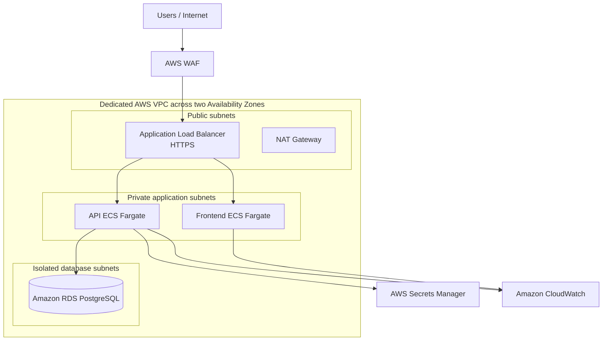

# Three-Tier Cloud Security Capstone on AWS

> **Project status:** Architecture and implementation starter. A live AWS deployment and security validation have not yet been evidenced. This repository must not be represented as production-ready or formally compliant until the pending work below is completed.

A cloud security capstone that designs a segmented three-tier web application on Amazon Web Services (AWS). The proposed application separates the public web frontend, private API service, and private PostgreSQL database, with security controls including AWS WAF, HTTPS, IAM roles, Secrets Manager, security groups, encryption, and CloudWatch logging.

**Repository:** [viperbeast69/three-tier-cloud-security-capstone](https://github.com/viperbeast69/three-tier-cloud-security-capstone)

---

## Table of contents

- [Project objectives](#project-objectives)
- [Architecture](#architecture)
- [Technology stack](#technology-stack)
- [Repository structure](#repository-structure)
- [Run the application locally](#run-the-application-locally)
- [AWS deployment overview](#aws-deployment-overview)
- [Security controls](#security-controls)
- [Risk assessment and framework mapping](#risk-assessment-and-framework-mapping)
- [Cost considerations](#cost-considerations)
- [Validation checklist](#validation-checklist)
- [Known limitations and work remaining](#known-limitations-and-work-remaining)
- [Documentation](#documentation)
- [Responsible use and security](#responsible-use-and-security)

## Project objectives

1. Apply cloud computing concepts and service/deployment models to a practical use case.
2. Design a three-tier architecture using cloud networking, compute, storage, and virtualization/container services.
3. Apply identity, access, application, network, and data security controls.
4. Identify threats, estimate risk, and map controls to a recognized security framework.
5. Define monitoring, logging, auditing, cost management, and validation activities.

## Architecture



### Request flow

1. A user connects to the application over HTTPS.
2. AWS WAF evaluates the incoming request.
3. The Application Load Balancer routes normal page requests to the frontend and `/api/*` requests to the API.
4. The API retrieves database credentials from AWS Secrets Manager and connects to PostgreSQL.
5. Frontend and API container logs are sent to CloudWatch.

## Technology stack

| Area | Technology |
|---|---|
| Cloud platform | Amazon Web Services (AWS) |
| Infrastructure as Code | Terraform |
| Containerization | Docker |
| Container runtime | Amazon ECS with AWS Fargate |
| Frontend | Nginx and HTML/CSS/JavaScript |
| API | Python and Flask |
| Database | Amazon RDS for PostgreSQL |
| Image registry | Amazon Elastic Container Registry (ECR) |
| Network | Amazon VPC, subnets, route tables, NAT Gateway, security groups |
| Edge security | AWS WAF and Application Load Balancer |
| Identity and secrets | AWS IAM and Secrets Manager |
| Monitoring | Amazon CloudWatch; CloudTrail is a recommended follow-up |

## Repository structure

The current GitHub repository contains the project inside a nested `three-tier-cloud-security-capstone/` directory. The paths below are relative to that folder.

```text
three-tier-cloud-security-capstone/
├── app/
│   ├── api/
│   │   ├── Dockerfile
│   │   ├── app.py
│   │   └── requirements.txt
│   └── frontend/
│       ├── Dockerfile
│       ├── nginx.conf
│       └── index.html
├── docs/
│   ├── architecture.md
│   ├── cloud-concepts-and-design.md
│   ├── risk-assessment-framework-mapping.md
│   ├── security-compliance-report.md
│   ├── threat-model.md
│   └── validation-checklist.md
├── evidence/
│   └── README.md
├── terraform/
│   ├── main.tf
│   ├── variables.tf
│   ├── outputs.tf
│   └── terraform.tfvars.example
├── .gitignore
├── docker-compose.yml
├── LICENSE
└── README.md
```

## Run the application locally

### Prerequisites

- Docker Desktop or Docker Engine
- Docker Compose

### Start the services

Open a terminal in the project directory (the nested `three-tier-cloud-security-capstone` folder) and run:

```bash
docker compose up --build
```

Open [http://localhost:8080](http://localhost:8080).

The frontend includes a button that calls `/api/health`. The local Compose configuration also starts PostgreSQL.

### Stop the services

```bash
docker compose down
```

To remove the local database volume as well (this permanently deletes local test data):

```bash
docker compose down -v
```

> The Compose database password is a local demonstration credential only. Do not reuse it in AWS or production.

## AWS deployment overview

The Terraform configuration is an educational baseline. Before using it, review and correct the outstanding Terraform and IAM issues listed in [Known limitations and work remaining](#known-limitations-and-work-remaining).

### Prerequisites

- An AWS account and AWS CLI configured with appropriate permissions.
- Terraform version 1.5 or later.
- Docker.
- An ACM certificate in the same AWS region as the Application Load Balancer.
- A DNS name covered by that certificate.
- An AWS Budget alert and a reviewed cost estimate.

### Deployment outline

1. Review the Terraform code and correct the known issues.
2. Enter the `terraform/` directory.
3. Copy `terraform.tfvars.example` to `terraform.tfvars`.
4. Set the region, project name, domain name, and ACM certificate ARN.
5. Supply the database password securely through the `TF_VAR_db_password` environment variable. Do not commit it.
6. Run `terraform init`, `terraform fmt -recursive`, `terraform validate`, and `terraform plan`.
7. Review the plan and expected AWS charges before applying.
8. Apply the infrastructure to create the network, WAF, load balancer, database, IAM resources, and ECR repositories.
9. Build and push the frontend and API images to ECR.
10. Enable the ECS services only after the images exist, then apply Terraform again.
11. Configure DNS and verify HTTPS, application health, security controls, logs, and cost.

Example validation commands:

```bash
terraform init
terraform fmt -recursive
terraform validate
terraform plan
```

Do not run `terraform apply` until the plan, permissions, cost, and configuration have been reviewed. Do not commit Terraform state files, credentials, real secret values, or populated `.tfvars` files.

When the lab is complete and evidence has been saved, review the destruction plan and remove resources that are no longer needed:

```bash
terraform destroy
```

AWS services used by this design can incur charges even during a short lab. See the cost documentation before deployment.

## Security controls

| Security area | Proposed control |
|---|---|
| Network segmentation | Public ALB, private application subnets, isolated database subnets |
| Inbound access | ALB accepts web traffic; application tasks accept traffic from the ALB security group |
| Database access | PostgreSQL port 5432 allowed only from the application security group |
| Transport | HTTPS listener and HTTP-to-HTTPS redirect |
| Web filtering | AWS WAF managed common rule group and rate-based rule |
| Identity | Separate ECS task execution and application task roles |
| Secrets | Database credentials stored in Secrets Manager |
| Data at rest | RDS storage encryption |
| Container registry | ECR scan-on-push |
| Logging | CloudWatch log groups for frontend and API containers |

A control is not considered validated merely because it appears in Terraform. Capture evidence that the deployed AWS resource has the intended configuration and that the control works.

## Risk assessment and framework mapping

The project documentation includes a qualitative 5 × 5 risk model and a risk register covering:

- SQL injection and unsafe input handling
- Public database exposure
- Credential leakage
- Excessive IAM permissions
- Request flooding and denial of service
- Vulnerable container images
- Availability and database failure
- Insufficient audit logging
- Unexpected cloud spend

The documentation maps the security activities to the six NIST Cybersecurity Framework 2.0 functions:

- Govern
- Identify
- Protect
- Detect
- Respond
- Recover

This is an educational mapping, not a formal audit, certification, or claim of compliance.

## Cost considerations

The architecture may incur charges for:

- Application Load Balancer
- NAT Gateway and data processing
- ECS Fargate task runtime
- RDS PostgreSQL instance and storage
- AWS WAF
- CloudWatch log ingestion and retention
- ECR image storage
- Data transfer

Use the [AWS Pricing Calculator](https://calculator.aws/) for the selected region, task sizes, database class, hours, and traffic. Set an AWS Budget alert before deployment. Record actual charges from AWS billing/Cost Explorer after the lab. Do not treat example estimates as actual costs.

## Validation checklist

Before describing the project as deployed or complete, verify and record:

- [ ] Terraform formatting, validation, and plan complete successfully.
- [ ] Frontend loads through the Application Load Balancer.
- [ ] `/api/health` returns HTTP 200.
- [ ] HTTP redirects to HTTPS and the certificate matches the hostname.
- [ ] AWS WAF Web ACL is associated with the ALB.
- [ ] ECS tasks have no public IP addresses.
- [ ] RDS is not publicly accessible.
- [ ] Database security group permits TCP 5432 only from the API tier.
- [ ] API can retrieve the secret and connect to the database.
- [ ] RDS storage encryption is enabled.
- [ ] Application logs are visible in CloudWatch.
- [ ] CloudTrail account activity logging is enabled and reviewed.
- [ ] Container image scan findings are reviewed.
- [ ] Cost estimate, budget alert, and actual lab spend are recorded.
- [ ] Lab resources are removed when no longer needed.

Store genuine screenshots and logs in `evidence/`. Redact account-sensitive information and never expose secret values.

## Known limitations and work remaining

The current repository is a starter implementation and has not been verified as deployed to AWS. Before deployment, address these issues:

1. **Terraform syntax:** The ECS service resource declarations were identified for correction because literal `\n` text appears in the published source. Replace it with actual line breaks and run Terraform formatting and validation.
2. **Secrets Manager IAM permission:** ECS task-definition secret injection requires the ECS task execution role to retrieve the secret. Ensure the narrowly scoped `secretsmanager:GetSecretValue` permission is attached to the execution role, not only the application task role.
3. **CloudTrail:** The documentation recommends CloudTrail, but the current Terraform baseline does not provision a trail. Configure and validate it.
4. **CloudWatch log encryption:** Review the log group encryption configuration. Add a customer-managed KMS key if required by the project's security policy.
5. **ECR tag immutability:** The current baseline uses mutable tags. Use immutable release tags or a controlled release workflow for production.
6. **Availability:** The baseline uses one NAT Gateway, one ECS task per service, and a single-AZ RDS instance. This is a cost-conscious lab design, not a high-availability production architecture.
7. **Network boundaries:** Consider separate frontend and API security groups to narrow permitted east-west traffic.
8. **DNS and unused variables:** Review the declared domain and administrative CIDR variables; either implement their intended behavior or remove/document them.

Do not claim that a deployment, penetration test, compliance audit, or security validation passed until you have performed it and saved the evidence.

## Documentation

Detailed project documents are located in `docs/`:

- [Architecture and design](docs/architecture.md)
- [Cloud concepts, service models, deployment models, and cost](docs/cloud-concepts-and-design.md)
- [Threat model](docs/threat-model.md)
- [Risk assessment and NIST CSF 2.0 mapping](docs/risk-assessment-framework-mapping.md)
- [Security and compliance readiness report](docs/security-compliance-report.md)
- [Deployment and validation checklist](docs/validation-checklist.md)

The capstone report PDF should be kept in the repository root or a dedicated `reports/` folder after it is finalized and reviewed.

## Responsible use and security

This project is intended for authorized cloud learning, architecture design, and defensive security assessment. Deploy only in an AWS account you own or are authorized to administer. Review costs and permissions before provisioning resources.

If you discover a security issue, do not publish credentials, personal data, or exploitable details. Report it privately to the repository maintainer.

---

**Maintainer:** [@viperbeast69](https://github.com/viperbeast69)  
**License:** See [LICENSE](LICENSE).
