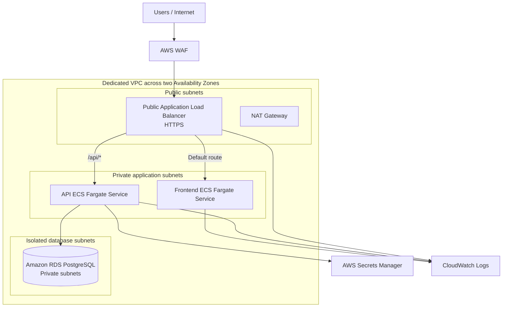

# Three-Tier Cloud Application — Secure AWS Capstone

A GitHub-ready capstone starter for designing and deploying a secure three-tier web application on AWS.

**Architecture:** Internet → AWS WAF → Application Load Balancer → Frontend ECS service / API ECS service → private Amazon RDS PostgreSQL.

> **Important:** This repository contains infrastructure-as-code, application source, security controls, and report templates. It has not been deployed to an AWS account. Do not claim deployment, penetration testing, compliance certification, or successful validation until you have performed and documented those activities yourself.

## 1. Architecture



### Security boundaries

- Only the load balancer is internet-facing.
- HTTPS is enforced at the load balancer; HTTP redirects to HTTPS.
- Frontend and API tasks run in private subnets.
- The database is not publicly accessible.
- Security groups permit only required tier-to-tier traffic.
- RDS storage and CloudWatch log groups are encrypted.
- The API database password is injected from Secrets Manager.
- ECS task execution and task roles use separate IAM roles.
- AWS WAF managed rule groups provide a baseline web-attack filter.
- CloudWatch receives application logs.

## 2. Repository structure

```text
.
├── app/
│   ├── api/
│   │   ├── Dockerfile
│   │   ├── app.py
│   │   └── requirements.txt
│   └── frontend/
│       ├── Dockerfile
│       ├── nginx.conf
│       └── index.html
├── docs/
│   ├── architecture.md
│   ├── security-compliance-report.md
│   ├── threat-model.md
│   └── validation-checklist.md
├── terraform/
│   ├── main.tf
│   ├── variables.tf
│   ├── outputs.tf
│   └── terraform.tfvars.example
├── .gitignore
├── docker-compose.yml
└── LICENSE
```

## 3. Run locally

Requirements: Docker Desktop or Docker Engine with Docker Compose.

```bash
docker compose up --build
```

Open `http://localhost:8080`. The frontend calls the API through `/api/health`.

Stop:

```bash
docker compose down
```

## 4. Deploy to AWS

### Prerequisites

- An AWS account and configured AWS CLI credentials.
- Terraform >= 1.5.
- Docker.
- An ACM certificate in the **same AWS region** as the ALB, covering the domain you will use.
- A registered domain and DNS access if you want public HTTPS.

### Step A — Build and push the images

First create the ECR repositories with Terraform (Step B), then authenticate and push:

```bash
cd terraform
cp terraform.tfvars.example terraform.tfvars
# Edit terraform.tfvars. Set aws_region, project_name, certificate_arn,
# and your public IP CIDR in allowed_admin_cidr if needed.
terraform init
terraform fmt -recursive
terraform validate
terraform plan
terraform apply
```

The first apply creates the network, database, WAF, load balancer, IAM roles, and ECR repositories. ECS services remain disabled until images exist. After Terraform creates the ECR repositories, from the repository root:

```bash
AWS_REGION=ap-south-1
ACCOUNT_ID=$(aws sts get-caller-identity --query Account --output text)
REGISTRY="${ACCOUNT_ID}.dkr.ecr.${AWS_REGION}.amazonaws.com"

aws ecr get-login-password --region "$AWS_REGION" | docker login --username AWS --password-stdin "$REGISTRY"

docker build -t "$REGISTRY/viper-capstone-frontend:latest" app/frontend
docker build -t "$REGISTRY/viper-capstone-api:latest" app/api
docker push "$REGISTRY/viper-capstone-frontend:latest"
docker push "$REGISTRY/viper-capstone-api:latest"
```

Then update the ECS services to pull the newly pushed images:

```bash
cd terraform
terraform apply
```

For a repeatable production workflow, add a CI/CD pipeline that builds, scans, signs, and deploys immutable image tags. Do not use `latest` for production releases.

### Step B — DNS and HTTPS

- Create an alias record in Route 53 (or your DNS provider) pointing to the ALB DNS name.
- Ensure the ACM certificate covers the hostname.
- Set `domain_name` in `terraform.tfvars`.
- Verify the ALB listener uses the certificate and HTTP redirects to HTTPS.

### Step C — Validate

Follow `docs/validation-checklist.md` and save real screenshots/logs for your submission.

### Step D — Destroy resources when finished

AWS resources can incur charges. When you no longer need the environment:

```bash
cd terraform
terraform destroy
```

Review the plan carefully before confirming. RDS deletion protection is disabled in this educational configuration; take a backup first if you need to retain data.

## 5. Security and cost notes

- This educational deployment uses one NAT Gateway to reduce complexity; NAT Gateway, ALB, Fargate, RDS, WAF, data transfer, and log ingestion may incur charges.
- Choose the smallest suitable task/database sizes for a short lab and destroy resources after testing.
- The example uses a single NAT Gateway and single-AZ RDS instance to limit cost; this is not a highly available production configuration.
- For production, use multi-AZ database deployment, multi-AZ NAT design, autoscaling, backups/PITR, alerting, centralized security logging, CI/CD controls, and a documented disaster-recovery plan.
- Restrict IAM permissions further before production use.
- Do not commit secrets, state files, credentials, `.env` files, or real customer data.

## 6. Submission checklist

- [ ] Architecture diagram and rationale reviewed.
- [ ] Terraform formatting and validation completed.
- [ ] Images built and pushed to ECR.
- [ ] AWS deployment completed successfully.
- [ ] HTTPS, WAF, private subnet placement, and database isolation verified.
- [ ] Evidence screenshots added under `evidence/` (only genuine screenshots).
- [ ] Security and compliance report updated with actual test results.
- [ ] Costs reviewed and resources destroyed if no longer required.

## 7. Suggested GitHub upload

Create a new public or private GitHub repository, then upload the contents of this folder (not the ZIP itself if you want the files visible immediately). Never upload `terraform.tfstate`, credentials, or secrets.
